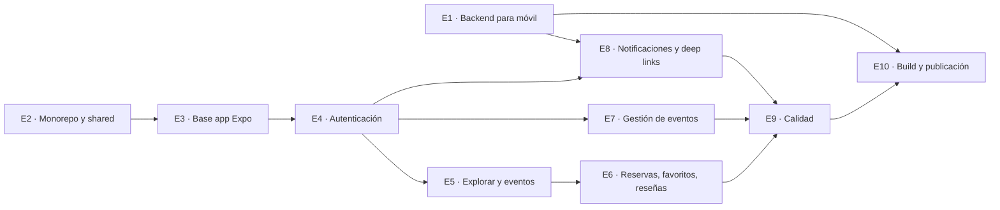

# Plan: app móvil de El Desván (Android)

> Resumen de la conversación de planificación (octubre 2026). Recoge las decisiones tomadas, la arquitectura, cómo se generará la app para Google Play y el plan de trabajo importado en Jira.

- **Plan visual (épicas, dependencias, roadmap):** https://claude.ai/artifact/AaM31QuS6A5ixsGE1syrLZ (privado; compartir desde el menú *Compartir*)
- **CSV para Jira:** [jira-plan-app-movil.csv](jira-plan-app-movil.csv)
- **Proyecto Jira:** espacio **El Desvan**, clave `DESV`, plantilla Scrum, gestionado por el equipo

---

## 1. Decisiones tomadas

| Tema | Decisión | Motivo |
|---|---|---|
| Tecnología móvil | **React Native con Expo** | Se necesita rendimiento nativo. Se descartó Capacitor (WebView) |
| Web | **Se mantiene en React + Vite** | No reescribir lo que ya funciona |
| Organización del código | **Monorepo** con lógica compartida | Web y app comparten services, store y design tokens |
| Backend | **Flask sin cambios de arquitectura** | La API es el contrato común de web y móvil |
| Panel de administración | **Solo web** | No compensa portarlo a móvil |
| Build y publicación | **EAS Build + EAS Submit** | Compila en la nube; funciona desde Windows |

### Cómo lo hacen otros marketplaces

Wallapop, Vinted, Milanuncios y coches.net tienen apps **nativas puras** (Kotlin/Swift) y repos separados por plataforma, con equipos dedicados a cada una. Comparten contratos (API, design system), no código. Para un equipo de dos personas eso es inviable, de ahí React Native + lógica compartida (el enfoque de Shopify, Discord o Coinbase). Lo que sí copiamos:

1. La API es la única fuente de verdad de las reglas de negocio.
2. Design tokens comunes para web y app.
3. Versionado de la API (`/api/v1`): las apps antiguas siguen instaladas durante meses.

---

## 2. Arquitectura del monorepo

```
Project-DESVAN/
├── apps/
│   ├── web/          ← React + Vite actual
│   └── mobile/       ← app Expo
├── packages/
│   └── shared/       ← services, store, config, validaciones, design tokens
└── src/api/          ← Flask (sin cambios)
```

`package.json` raíz:

```json
{
  "private": true,
  "workspaces": ["apps/*", "packages/*"]
}
```

### Refactor previo necesario

1. **`localStorage` está repartido por todo el front** (services, `store.js`, `ProtectedRoute`, `AdminRoute`, `NotificationBell`, `Details`…). Hay que sustituirlo por una abstracción `tokenStorage.get/set/remove`:
   - web → `localStorage`
   - móvil → `expo-secure-store` (cifrado, **asíncrono**: `initialStore` deja de poder leer el token de forma síncrona)
2. **`import.meta.env.VITE_BACKEND_URL`** es de Vite. Los services deben recibir la URL desde fuera (web: `VITE_BACKEND_URL`; móvil: `EXPO_PUBLIC_BACKEND_URL`).

### Qué se reutiliza y qué se reescribe

| Se reutiliza | Se reescribe |
|---|---|
| API de Flask | Páginas y componentes (~33 ficheros, ~6.300 líneas JSX) |
| `services/*.service.js` | Estilos (`StyleSheet` en lugar de CSS) |
| `store.js` (reducer) | Router (Expo Router) |
| Validaciones | Mapa (`react-native-maps` en lugar del iframe de Google Maps) |

### Equivalencias de funcionalidades

| Funcionalidad | En móvil |
|---|---|
| Navegación y rutas protegidas | Expo Router |
| Mapa y eventos cercanos | `react-native-maps` + `expo-location` |
| Subida a Cloudinary | `expo-image-picker` + el mismo endpoint |
| Notificaciones y recordatorio 24 h | `expo-notifications`; Flask envía vía Expo Push / FCM |
| Recuperar contraseña | Deep links (`expo-linking`) + Android App Links (`assetlinks.json`) |
| Listas de eventos | `FlatList` / `FlashList` |

---

## 3. Generar la app para Google Play

> Google Play **no acepta APK** para publicar: pide **AAB** (Android App Bundle). El APK solo sirve para instalar y probar.

### `apps/mobile/eas.json`

```json
{
  "build": {
    "development": { "developmentClient": true, "distribution": "internal" },
    "preview": {
      "android": { "buildType": "apk" },
      "distribution": "internal",
      "env": { "EXPO_PUBLIC_BACKEND_URL": "https://<staging>.onrender.com/" }
    },
    "production": {
      "android": { "buildType": "app-bundle" },
      "autoIncrement": true,
      "env": { "EXPO_PUBLIC_BACKEND_URL": "https://<produccion>.onrender.com/" }
    }
  },
  "submit": {
    "production": {
      "android": { "serviceAccountKeyPath": "./play-service-account.json", "track": "internal" }
    }
  }
}
```

### Comandos (desde `apps/mobile`)

```bash
npm install -g eas-cli
eas login
eas build:configure
eas build -p android --profile preview      # APK para probar
eas build -p android --profile production   # AAB para Play Store
eas submit -p android --profile production  # subir a Play Console
```

### A tener en cuenta

- **Keystore:** dejar que la gestione EAS y activar **Play App Signing**. Si se pierde, no se puede actualizar la app.
- **Primera subida a mano** desde Play Console; después ya funciona `eas submit` con una service account (el JSON **nunca** en el repo).
- `eas build --local` **no funciona en Windows** (solo macOS/Linux/WSL).
- Alternativa local: `npx expo prebuild -p android` y `./gradlew bundleRelease` (requiere Android Studio + JDK).
- **CI (más adelante):** GitHub Actions con `expo/expo-github-action`, disparado solo con cambios en `apps/mobile/**` o `packages/shared/**`.

### Requisitos de Google Play

- Cuenta de desarrollador: 25 $, pago único.
- **Borrado de cuenta** desde la app y desde una URL web pública (hoy no existe en la API).
- Política de privacidad pública y formulario de seguridad de datos.
- Cuentas personales nuevas: **prueba cerrada con 12 testers durante 14 días** antes de publicar en producción. Reclutar testers desde el sprint 6.

---

## 4. Jira

### Cómo se importó

1. Proyecto **El Desvan** (Scrum, gestionado por el equipo, clave `DESV`). El proyecto antiguo "Desvan" era Kanban y no tiene sprints.
2. Importación CSV con este mapeo:

| Columna CSV | Campo Jira |
|---|---|
| Issue Id | Work item id |
| Parent Id | Principal |
| Issue Type | Tipo de incidencia (`Epic` → Épica, `Story` → Historia) |
| Summary | Resumen |
| Description | Descripción |
| Story Points | **Story point estimate** (el campo numérico, no el de icono Aα) |
| Labels (×3) | Etiquetas |

### Problemas encontrados

- El Tablero de Scrum solo muestra el **sprint activo**; las historias importadas están en el **Backlog**.
- La primera importación dejó los **story points vacíos** porque se mapearon a un campo de texto. El CSV de `docs/` ya tiene las etiquetas en columnas separadas y no incluye la columna Sprint.
- Los sprints de Jira se llaman `DESV Sprint N`, así que no se mapea la columna Sprint. Para llenar cada sprint: **Filtro → Etiqueta → `sprint-N`** y arrastrar las historias.
- Las historias aparecen en orden inverso en el backlog; no afecta si se planifica por etiqueta.

---

## 5. Plan de trabajo

**10 épicas · 68 historias · 197 story points · 8 sprints de 2 semanas (~16 semanas)**

Camino crítico: **E2 Monorepo → E3 Base Expo → E4 Autenticación**, y de ahí cuelga el resto. E1 (backend) avanza en paralelo.



| Sprint | S1 | S2 | S3 | S4 | S5 | S6 | S7 | S8 |
|---|---|---|---|---|---|---|---|---|
| Puntos | 21 | 26 | 29 | 26 | 26 | 29 | 29 | 11 |

El sprint 8 tiene pocos puntos a propósito: lo ocupa la prueba cerrada de Google Play.

### E1 · Preparar el backend para móvil (18 pts)

La API de Flask es el contrato común: compatibilidad entre versiones y requisitos de Google Play.

| ID | Historia | Área | Pts | Sprint | Depende de |
|---|---|---|---|---|---|
| E1-01 | Versionar la API (/api/v1) sin romper la web | Backend | 3 | S1 | — |
| E1-02 | Endpoint para borrar la cuenta | Backend | 5 | S1 | — |
| E1-03 | Página web pública de borrado de cuenta | Web | 2 | S1 | E1-02 |
| E1-04 | Política de privacidad pública | Web | 2 | S1 | — |
| E1-05 | Revisar CORS y orígenes permitidos | Backend | 1 | S1 | — |
| E1-06 | Modelo PushToken y endpoint de registro | Backend | 3 | S6 | — |
| E1-07 | Endpoint de salud y mitigar cold start de Render | Backend | 2 | S6 | — |

### E2 · Monorepo y código compartido (28 pts)

Reorganizar el repo para que web y móvil compartan services, store y design tokens.

| ID | Historia | Área | Pts | Sprint | Depende de |
|---|---|---|---|---|---|
| E2-01 | Configurar npm workspaces en la raíz | Shared | 2 | S1 | — |
| E2-02 | Mover el front a apps/web | Web | 3 | S1 | E2-01 |
| E2-03 | Crear packages/shared | Shared | 2 | S1 | E2-01 |
| E2-04 | Abstraer el almacenamiento del token | Shared | 5 | S2 | E2-03 |
| E2-05 | URL del backend inyectable | Shared | 3 | S2 | E2-03 |
| E2-06 | Mover services y store a shared | Shared | 5 | S2 | E2-04 |
| E2-07 | Hidratación asíncrona de la sesión | Shared | 3 | S2 | E2-06 |
| E2-08 | Design tokens compartidos | Shared | 3 | S2 | E2-03 |
| E2-09 | Regresión manual de la web | Calidad | 2 | S2 | E2-07 |

### E3 · Base de la app Expo (18 pts)

Esqueleto de la app con navegación, componentes base y build de desarrollo.

| ID | Historia | Área | Pts | Sprint | Depende de |
|---|---|---|---|---|---|
| E3-01 | Crear apps/mobile con Expo y Expo Router | Móvil | 2 | S2 | E2-01 |
| E3-02 | Consumir @desvan/shared desde la app | Móvil | 2 | S2 | E2-06 |
| E3-03 | tokenStorage con expo-secure-store | Móvil | 2 | S3 | E2-04 |
| E3-04 | Navegación principal | Móvil | 3 | S3 | E3-01 |
| E3-05 | Componentes UI base | Móvil | 5 | S3 | E2-08 |
| E3-06 | Gestión de errores de red y carga inicial | Móvil | 2 | S3 | E3-01 |
| E3-07 | Development build con EAS | Móvil | 2 | S3 | E3-01 |

### E4 · Autenticación (13 pts)

Registro, inicio de sesión y perfil completo para poder publicar eventos.

| ID | Historia | Área | Pts | Sprint | Depende de |
|---|---|---|---|---|---|
| E4-01 | Pantalla de inicio de sesión | Móvil | 3 | S3 | E3-03 |
| E4-02 | Pantalla de registro | Móvil | 3 | S3 | E3-05 |
| E4-03 | Solicitar recuperación de contraseña | Móvil | 2 | S3 | E4-01 |
| E4-04 | Rutas protegidas y cierre de sesión | Móvil | 2 | S3 | E4-01 |
| E4-05 | Completar perfil (teléfono y dirección) | Móvil | 3 | S4 | E4-01 |

### E5 · Explorar y eventos (25 pts)

Descubrir eventos: listado, filtros, mapa, cercanía y detalle.

| ID | Historia | Área | Pts | Sprint | Depende de |
|---|---|---|---|---|---|
| E5-01 | Listado de eventos con FlashList | Móvil | 5 | S3 | E3-05 |
| E5-02 | Filtros por categoría, etiquetas y búsqueda | Móvil | 3 | S4 | E5-01 |
| E5-03 | Detalle de evento | Móvil | 5 | S4 | E5-01 |
| E5-04 | Mapa de eventos con react-native-maps | Móvil | 5 | S4 | E5-01 |
| E5-05 | Eventos cercanos con expo-location | Móvil | 3 | S4 | E5-04 |
| E5-06 | Abrir “Cómo llegar” en Google Maps | Móvil | 1 | S4 | E5-03 |
| E5-07 | Perfil público del vendedor | Móvil | 3 | S4 | E5-03 |

### E6 · Reservas, favoritos y reseñas (14 pts)

La parte de cliente: guardar, reservar y valorar.

| ID | Historia | Área | Pts | Sprint | Depende de |
|---|---|---|---|---|---|
| E6-01 | Favoritos | Móvil | 3 | S4 | E5-03 |
| E6-02 | Reservar y cancelar plaza | Móvil | 3 | S5 | E5-03 |
| E6-03 | Mis reservas | Móvil | 3 | S5 | E6-02 |
| E6-04 | Valorar al organizador | Móvil | 3 | S5 | E6-03 |
| E6-05 | Reportar usuario o evento | Móvil | 2 | S5 | E5-03 |

### E7 · Gestión de eventos (vendedor) (29 pts)

Publicar y administrar eventos propios desde el móvil.

| ID | Historia | Área | Pts | Sprint | Depende de |
|---|---|---|---|---|---|
| E7-01 | Crear evento: formulario por pasos | Móvil | 8 | S5 | E4-05 |
| E7-02 | Selectores nativos de fecha y hora | Móvil | 2 | S5 | E7-01 |
| E7-03 | Subida de imágenes con expo-image-picker | Móvil | 5 | S5 | E7-01 |
| E7-04 | Elegir ubicación en el mapa | Móvil | 5 | S6 | E5-04 |
| E7-05 | Editar y borrar evento | Móvil | 3 | S6 | E7-01 |
| E7-06 | Mis eventos y reservas recibidas | Móvil | 3 | S6 | E7-01 |
| E7-07 | Editar perfil y foto | Móvil | 3 | S6 | E7-03 |

### E8 · Notificaciones y deep links (23 pts)

Avisos push reales y enlaces que abren la app.

| ID | Historia | Área | Pts | Sprint | Depende de |
|---|---|---|---|---|---|
| E8-01 | Bandeja de notificaciones in-app | Móvil | 3 | S6 | E4-04 |
| E8-02 | Push: permisos y registro del token | Móvil | 3 | S6 | E1-06 |
| E8-03 | Envío de push desde Flask | Backend | 5 | S7 | E1-06 |
| E8-04 | Recordatorio 24 h antes del evento | Backend | 5 | S7 | E8-03 |
| E8-05 | Deep links y Android App Links | Móvil | 3 | S7 | E3-01 |
| E8-06 | Recuperar contraseña abre la app | Móvil | 2 | S7 | E8-05 |
| E8-07 | Pulsar una notificación abre su pantalla | Móvil | 2 | S7 | E8-02 |

### E9 · Calidad (12 pts)

Que la app funcione bien en móviles reales antes de publicarla.

| ID | Historia | Área | Pts | Sprint | Depende de |
|---|---|---|---|---|---|
| E9-01 | ESLint y Prettier en todo el monorepo | Calidad | 1 | S2 | E2-01 |
| E9-02 | Tests unitarios de @desvan/shared | Calidad | 3 | S7 | E2-06 |
| E9-03 | Pruebas en gama baja y alta | Calidad | 3 | S7 | E6-02 |
| E9-04 | Accesibilidad | Calidad | 3 | S7 | E3-05 |
| E9-05 | Informes de errores con Sentry | Calidad | 2 | S8 | E3-07 |

### E10 · Build y publicación en Google Play (17 pts)

Desde la cuenta de desarrollador hasta producción.

| ID | Historia | Área | Pts | Sprint | Depende de |
|---|---|---|---|---|---|
| E10-01 | Crear la cuenta de Google Play Developer | Play Store | 1 | S1 | — |
| E10-02 | Perfiles de EAS y variables de entorno | Móvil | 2 | S6 | E3-07 |
| E10-03 | Icono, splash y nombre de la app | Móvil | 2 | S6 | E3-01 |
| E10-04 | Firma y Play App Signing | Play Store | 1 | S8 | E10-01 |
| E10-05 | Ficha de Play Store | Play Store | 3 | S7 | E1-04 |
| E10-06 | Prueba cerrada: 12 testers durante 14 días | Play Store | 2 | S8 | E10-05 |
| E10-07 | Subida automática con eas submit | Play Store | 2 | S8 | E10-06 |
| E10-08 | CI con GitHub Actions | Calidad | 3 | S8 | E10-07 |
| E10-09 | Publicar en producción | Play Store | 1 | S8 | E10-06 |

